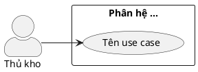

# Vẽ sơ đồ use case bằng PlantUML

## Trước khi sửa
1. Đọc `docs/dac-ta-nghiep-vu.md` để chắc use case có cơ sở trong đặc tả.
2. Đọc file `.puml` hiện có, tìm mã UC lớn nhất; use case mới lấy số tiếp theo.

## Khung mỗi khối

## Quan hệ
- Tác nhân → use case: `TK --> UCxx`.
- «include» (luôn xảy ra): `Base ..> Included : <<include>>`.
- «extend» (có điều kiện): `Extension ..> Base : <<extend>>` – mũi tên chỉ về use case gốc.
- Tổng quát hóa: `Con --|> Cha` (dùng cho tác nhân và cho các báo cáo con).

## Khi thêm use case
- Thêm vào cả sơ đồ phân hệ và sơ đồ tổng quát `0_TongQuat` (chỉ use case chính, không include/extend).
- Cập nhật mục "Bổ sung sau" trong `docs/dac-ta-nghiep-vu.md` và số UC lớn nhất trong `CLAUDE.md`.
- Tên use case là động từ + đối tượng, tiếng Việt có dấu, xuống dòng bằng `\n` nếu dài hơn ~22 ký tự.
