# Hướng dẫn sử dụng – Phần mềm quản lý cửa hàng đồ cơ khí

Tài liệu hướng dẫn từng bước cho **nhân viên bán hàng**, **thủ kho** và **chủ cửa hàng**.
Trong hình, các **số đỏ ①②③** đánh dấu đúng chỗ cần bấm hoặc nhập, theo thứ tự các bước bên dưới.

> Hình chụp từ dữ liệu mẫu, nên tên hàng, số tiền, ngày tháng có thể khác với cửa hàng của bạn.

## Mục lục

1. [Bắt đầu](#1-bắt-đầu)
   - [1.1 Đăng nhập](#11-đăng-nhập) · [1.2 Trang chính](#12-trang-chính) · [1.3 Dùng menu](#13-dùng-menu) · [1.4 Đăng xuất](#14-đăng-xuất)
2. [Nhân viên bán hàng](#2-nhân-viên-bán-hàng)
   - [2.1 Tra cứu hàng](#21-tra-cứu-tồn-kho-và-giá) · [2.2 Báo giá](#22-báo-giá-cho-khách) · [2.3 Lập phiếu bán](#23-lập-phiếu-bán) · [2.4 Xem lại phiếu bán](#24-xem-lại-phiếu-bán)
   - [2.5 Khách trả hàng](#25-khách-trả-hàng) · [2.6 Khách hàng](#26-quản-lý-khách-hàng) · [2.7 Tra cứu công nợ](#27-tra-cứu-công-nợ) · [2.8 Thu nợ](#28-thu-nợ) · [2.9 Khách đang nợ](#29-danh-sách-khách-đang-nợ)
3. [Thủ kho](#3-thủ-kho)
   - [3.1 Lập phiếu nhập](#31-lập-phiếu-nhập-hàng) · [3.2 Kiểm kê](#32-kiểm-kê-kho) · [3.3 Chuyển kho](#33-chuyển-kho)
4. [Chủ cửa hàng](#4-chủ-cửa-hàng)
   - [4.1 Hàng hóa & đơn vị](#41-hàng-hóa-và-đơn-vị-tính) · [4.2 Nhà cung cấp](#42-nhà-cung-cấp) · [4.3 Nhân viên](#43-nhân-viên) · [4.4 Báo cáo](#44-báo-cáo)
   - [4.5 Hủy phiếu bán](#45-hủy-phiếu-bán-lập-nhầm) · [4.6 Sửa giá / hủy phiếu nhập](#46-sửa-giá-nhập--hủy-phiếu-nhập) · [4.7 Ghi nợ đầu kỳ](#47-ghi-nợ-đầu-kỳ)
5. [Câu hỏi thường gặp](#5-câu-hỏi-thường-gặp)

---

## 1. Bắt đầu

### 1.1 Đăng nhập

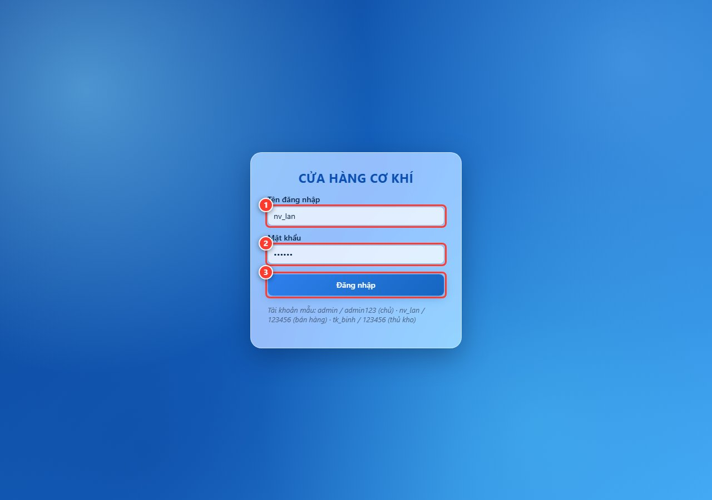

1. Mở trình duyệt (Chrome hoặc Edge) và vào địa chỉ phần mềm do người quản trị cung cấp, ví dụ `http://192.168.1.2:3000`.
2. Nhập **Tên đăng nhập** ①.
3. Nhập **Mật khẩu** ②.
4. Bấm **Đăng nhập** ③.

Nếu nhập sai, màn hình báo *"Sai tài khoản hoặc mật khẩu"* và giữ lại tên đăng nhập; bạn chỉ cần gõ lại mật khẩu.
Quên mật khẩu thì nhờ chủ cửa hàng đặt lại (xem [4.3](#43-nhân-viên)).

### 1.2 Trang chính

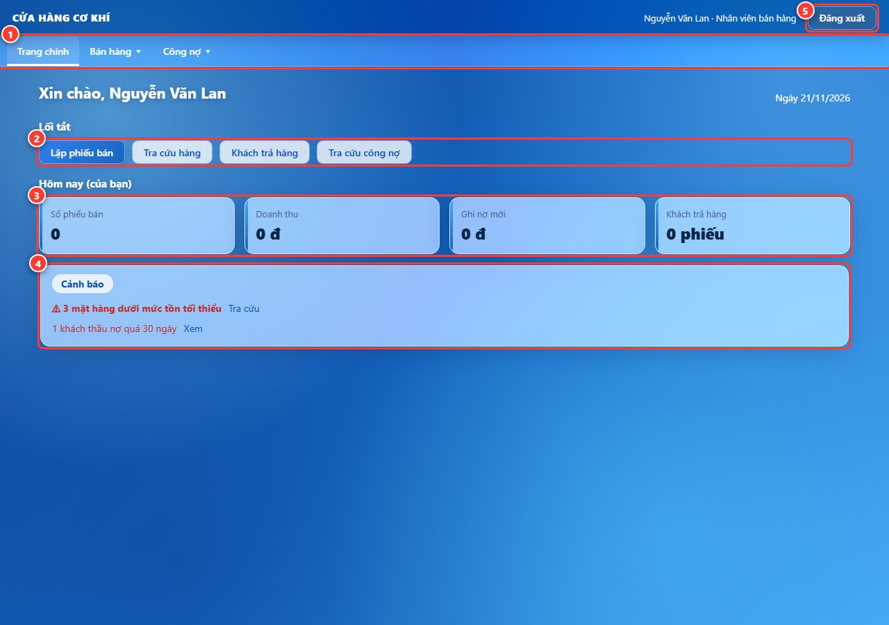

| Số | Khu vực | Ý nghĩa |
|---|---|---|
| ① | Thanh menu | Chỉ hiện những chức năng bạn được dùng: nhân viên bán hàng thấy *Bán hàng, Công nợ*; thủ kho thấy *Tra cứu, Kho*; chủ cửa hàng thấy tất cả. |
| ② | Lối tắt | Mở nhanh các việc hay làm nhất. |
| ③ | Hôm nay | Số phiếu bán, doanh thu, tiền ghi nợ, số phiếu trả hàng trong ngày (nhân viên chỉ thấy số của mình). |
| ④ | Cảnh báo | Số mặt hàng dưới mức tồn tối thiểu, số khách thầu nợ quá 30 ngày. Bấm **Xem / Tra cứu** để xem chi tiết. |
| ⑤ | Đăng xuất | Bấm khi rời máy. |

Trang chính của chủ cửa hàng có thêm các menu *Kho, Quản trị, Báo cáo*:

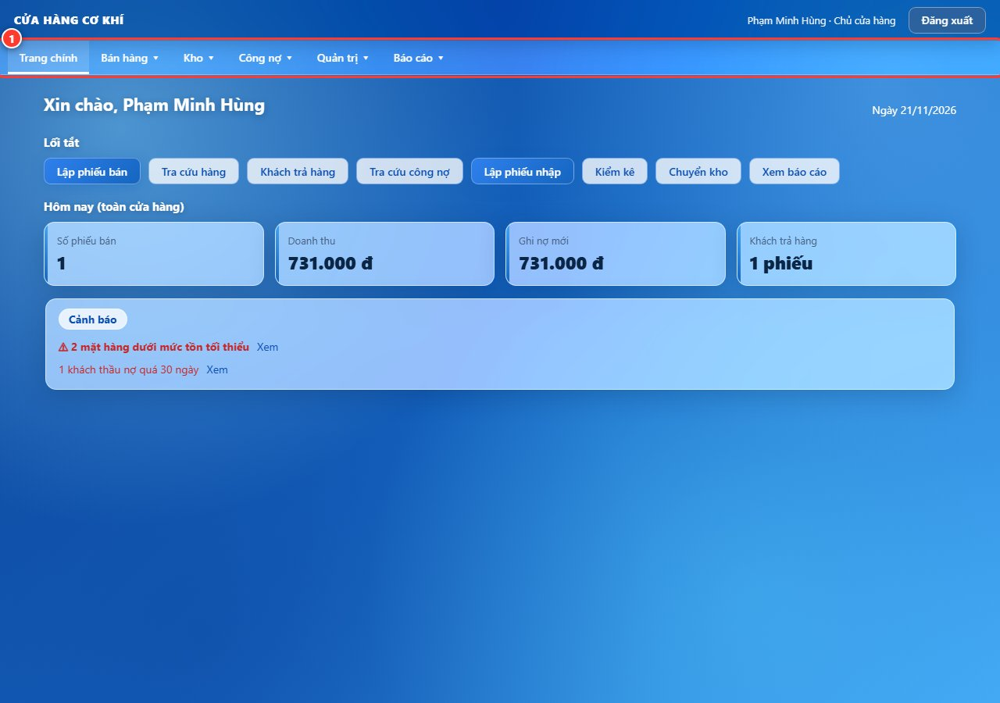

### 1.3 Dùng menu

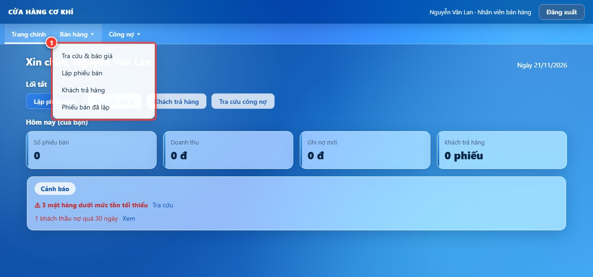

Đưa chuột vào tên nhóm (ví dụ **Bán hàng**), danh sách chức năng ① sẽ hiện ra. Bấm vào chức năng cần dùng.

### 1.4 Đăng xuất

Bấm **Đăng xuất** ở góc trên bên phải (⑤ trong hình 1.2). Phiên đăng nhập tự hết hạn sau 7 ngày. Bạn cũng bị đăng xuất ngay nếu chủ cửa hàng khóa tài khoản hoặc đặt lại mật khẩu của bạn.

---

## 2. Nhân viên bán hàng

### 2.1 Tra cứu tồn kho và giá

*Menu:* **Bán hàng → Tra cứu & báo giá**

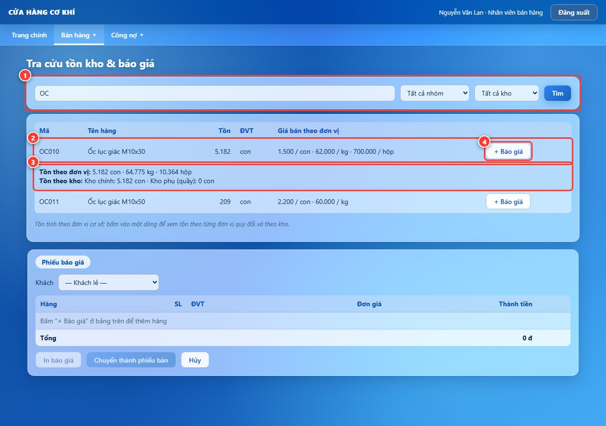

1. Gõ mã hoặc tên hàng vào ô tìm kiếm ①. Có thể chọn thêm **nhóm** và **kho**, rồi bấm **Tìm**.
2. Bảng kết quả ② cho biết **tồn kho** (theo đơn vị nhỏ nhất: con, mét, cái…) và **giá bán theo từng đơn vị**, ví dụ `1.500 / con · 62.000 / kg · 700.000 / hộp`.
   Số tồn **màu đỏ** nghĩa là hàng sắp hết. Nhãn **ngừng nhập** nghĩa là cửa hàng không nhập thêm món này nữa.
3. Bấm vào một dòng để xem thêm ③: tồn quy đổi ra từng đơn vị (được bao nhiêu kg, bao nhiêu hộp) và tồn ở từng kho.
4. Khách hỏi giá thì bấm **+ Báo giá** ④ để đưa món đó vào phiếu báo giá (xem 2.2).

### 2.2 Báo giá cho khách

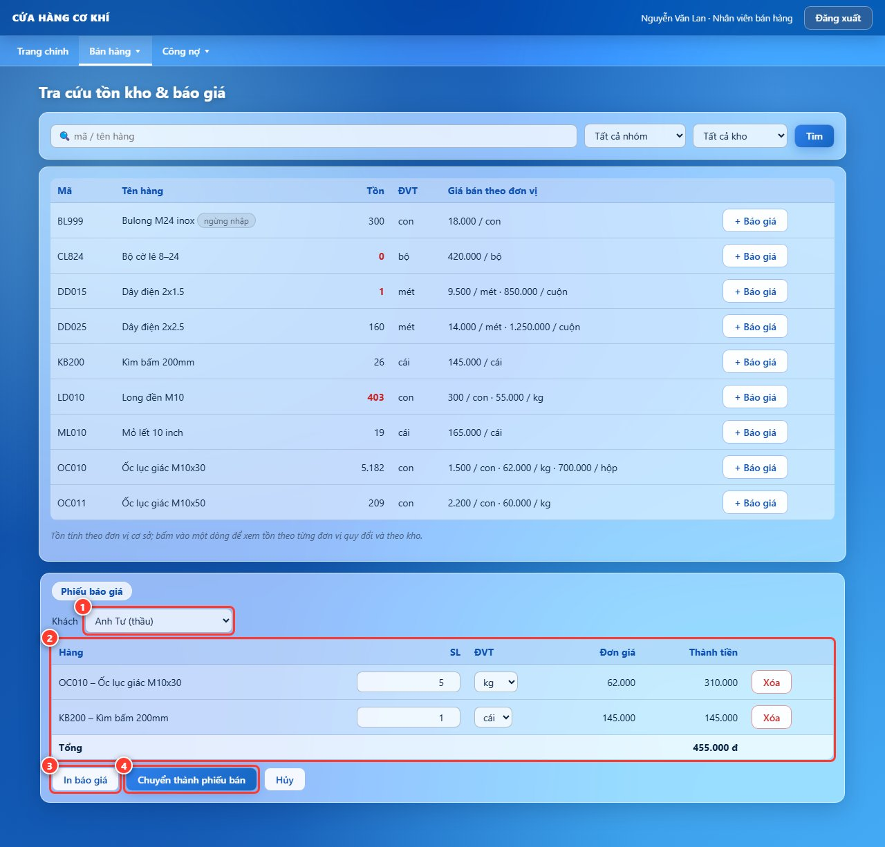

1. Ở bảng tra cứu, bấm **+ Báo giá** cho từng món khách hỏi. Các món được thêm vào khung **Phiếu báo giá** bên dưới.
2. Chọn **Khách** ① (để "Khách lẻ" nếu là khách vãng lai).
3. Trong bảng ②, sửa **số lượng** và **đơn vị tính**. Đơn giá tự đổi theo đơn vị, ví dụ chọn *kg* thì giá là 62.000/kg. Bấm **Xóa** để bỏ một món.
4. Bấm **In báo giá** ③ để in đưa khách,
   hoặc khi khách đồng ý mua thì bấm **Chuyển thành phiếu bán** ④. Phiếu bán mở ra với sẵn khách và các món đã báo giá (xem 2.3).

> Báo giá không giữ hàng và không trừ tồn kho.

### 2.3 Lập phiếu bán

*Menu:* **Bán hàng → Lập phiếu bán** (hoặc nút lối tắt **Lập phiếu bán**)

**Bước 1 – Chọn khách và thêm hàng**

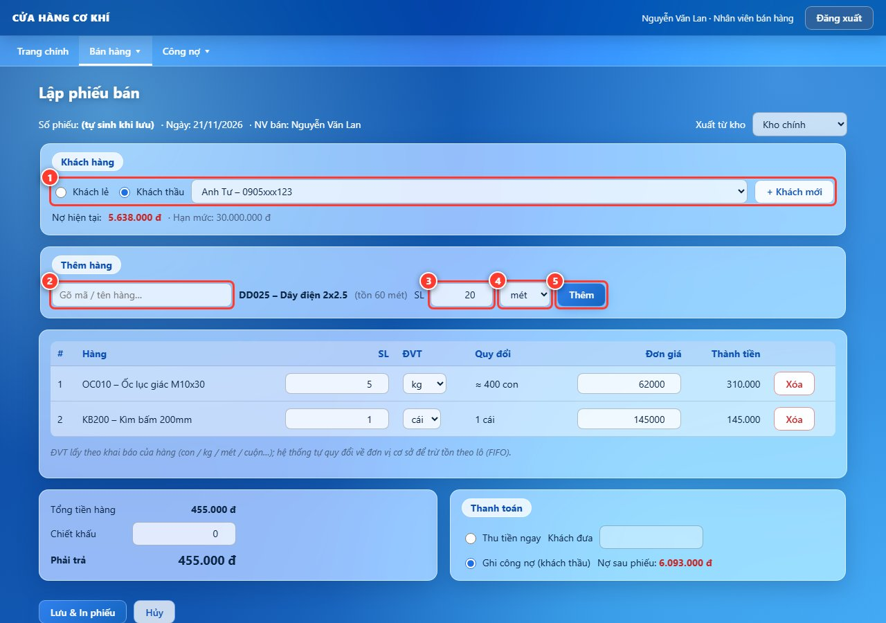

1. Chọn **Khách lẻ** hoặc **Khách thầu** ①.
   - Khách lẻ: có thể để trống (khách vãng lai) hoặc chọn khách lẻ quen.
   - Khách thầu: **bắt buộc** chọn tên khách. Bên dưới hiện **Nợ hiện tại** và **Hạn mức** nợ của khách.
   - Khách thầu mới chưa có trong danh sách: bấm **+ Khách mới**, thêm khách ở thẻ mới mở (xem 2.6), rồi quay lại tải lại trang.
2. Gõ mã hoặc tên hàng vào ô **Thêm hàng** ② và chọn trong danh sách gợi ý. Bên cạnh hiện tên hàng và số tồn hiện có.
3. Nhập **số lượng** ③.
4. Chọn **đơn vị tính** ④: con / kg / hộp / mét / cuộn… tùy món.
5. Bấm **Thêm** ⑤ (hoặc nhấn Enter). Lặp lại cho các món khác.

**Bước 2 – Kiểm tra và thanh toán**

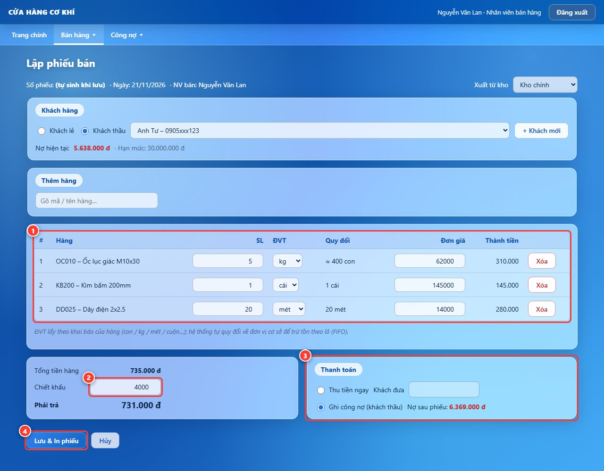

6. Kiểm tra bảng hàng ①:
   - Cột **Quy đổi** cho biết số lượng theo đơn vị nhỏ nhất, ví dụ 5 kg ốc ≈ 400 con. Kho sẽ trừ theo con số này.
   - Có thể sửa **SL**, **ĐVT**, **Đơn giá** ngay trong bảng, hoặc bấm **Xóa** để bỏ món.
   - Dòng có chữ đỏ **"Vượt tồn kho"** là không đủ hàng: giảm số lượng hoặc đổi **Xuất từ kho** ở góc trên.
7. Nhập **Chiết khấu** ② nếu có. **Phải trả** tự tính lại.
8. Chọn cách **Thanh toán** ③:
   - **Thu tiền ngay**: nhập số tiền khách đưa để biết **tiền thối lại**.
   - **Ghi công nợ** (chỉ khách thầu): màn hình hiện **Nợ sau phiếu**. Nếu hiện cảnh báo vàng *vượt hạn mức*, nên thu bớt tiền của khách.
9. Bấm **Lưu & In phiếu** ④.

**Bước 3 – In phiếu**

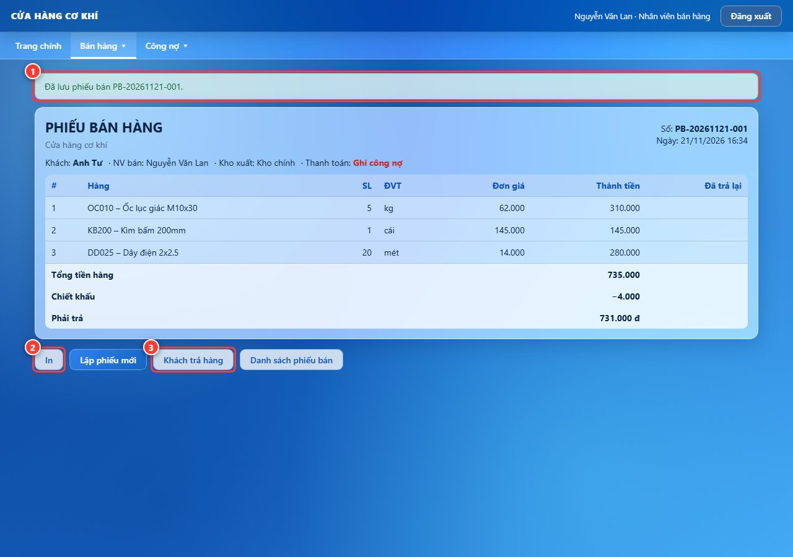

10. Phiếu đã lưu hiện thông báo kèm **số phiếu** ① (dạng `PB-20261121-001`).
11. Bấm **In** ② để in phiếu đưa khách.
12. Nếu khách trả lại hàng của phiếu này, bấm **Khách trả hàng** ③ (xem 2.5).

### 2.4 Xem lại phiếu bán

*Menu:* **Bán hàng → Phiếu bán đã lập**

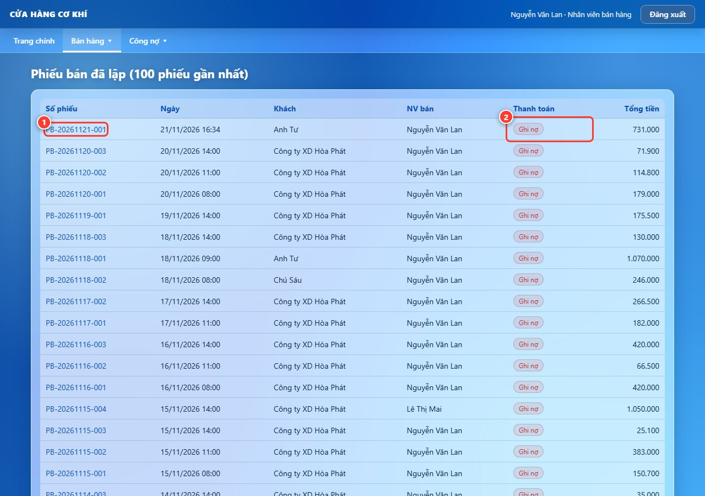

- Bấm vào **số phiếu** ① để mở và in lại.
- Cột **Thanh toán** ② cho biết phiếu thu **Tiền mặt**, **Ghi nợ** hay **Đã hủy**.

### 2.5 Khách trả hàng

*Menu:* **Bán hàng → Khách trả hàng**

**Bước 1 – Tìm phiếu bán gốc**

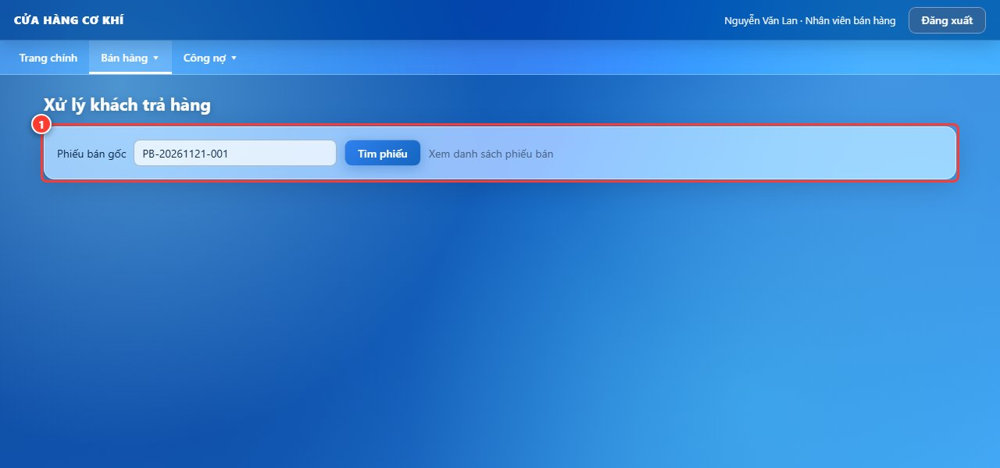

1. Nhập **số phiếu bán** in trên phiếu của khách vào ô ①, rồi bấm **Tìm phiếu**.

**Bước 2 – Chọn hàng trả**

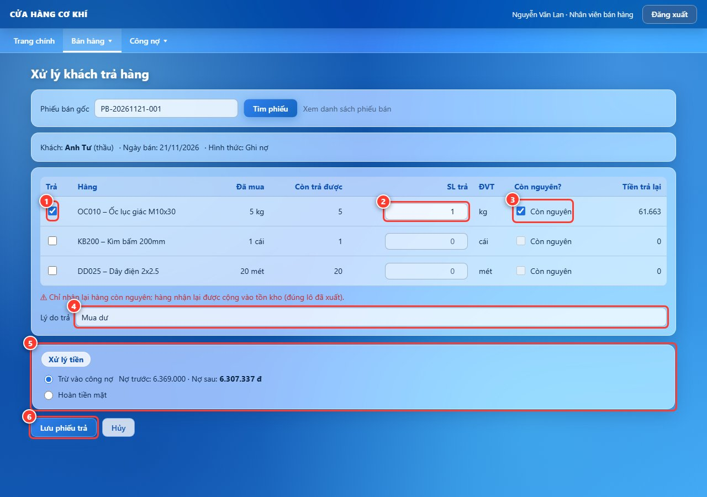

2. Đánh dấu ô **Trả** ① ở món khách trả.
3. Nhập **SL trả** ②. Không được nhập quá cột *Còn trả được*.
4. Kiểm tra hàng, nếu còn nguyên thì đánh dấu **Còn nguyên** ③.
   **Hàng không còn nguyên thì không nhận.** Phần mềm cũng không cho lưu dòng chưa đánh dấu ô này.
5. Nhập **Lý do trả** ④, ví dụ "Mua dư".
6. Chọn **Xử lý tiền** ⑤:
   - **Trừ vào công nợ** (khách thầu): màn hình hiện nợ trước và nợ sau khi trừ.
   - **Hoàn tiền mặt** (khách lẻ): đưa lại tiền cho khách theo số ở cột *Tiền trả lại*.
7. Bấm **Lưu phiếu trả** ⑥. Hàng tự cộng lại vào kho.

> **Vì sao tiền trả lại có số lẻ (ví dụ 61.663 đ)?** Nếu phiếu gốc có chiết khấu, phần chiết khấu được chia đều cho từng món. Tiền trả lại bằng đúng số khách đã thực trả cho món đó.

### 2.6 Quản lý khách hàng

*Menu:* **Công nợ → Khách hàng**

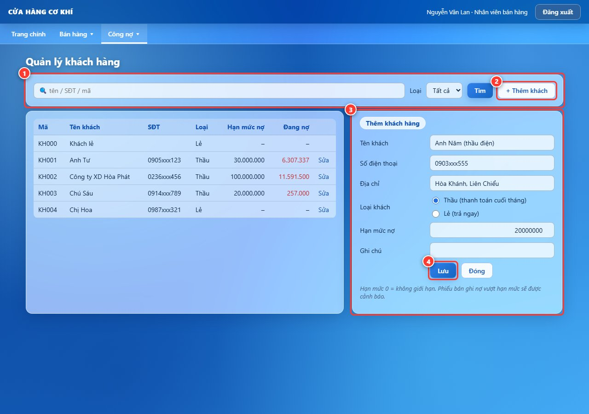

1. Tìm khách theo tên, số điện thoại hoặc mã ①. Có thể lọc theo loại khách (Thầu / Lẻ).
2. Bấm **+ Thêm khách** ② để thêm khách mới. Muốn sửa khách có sẵn thì bấm **Sửa** ở dòng của khách đó.
3. Điền thông tin vào khung ③:
   - **Loại khách:** chọn *Thầu* cho khách được ghi nợ, thanh toán cuối tháng; chọn *Lẻ* cho khách trả tiền ngay.
   - **Hạn mức nợ:** số nợ tối đa cho phép (để 0 nếu không giới hạn). Khi bán ghi nợ vượt mức này, phần mềm sẽ cảnh báo.
4. Bấm **Lưu** ④.

Cột *Đang nợ* trong danh sách là số tiền khách còn nợ; bấm vào số đó để xem chi tiết công nợ.

### 2.7 Tra cứu công nợ

*Menu:* **Công nợ → Công nợ & thu nợ** (thẻ **Tra cứu công nợ**)

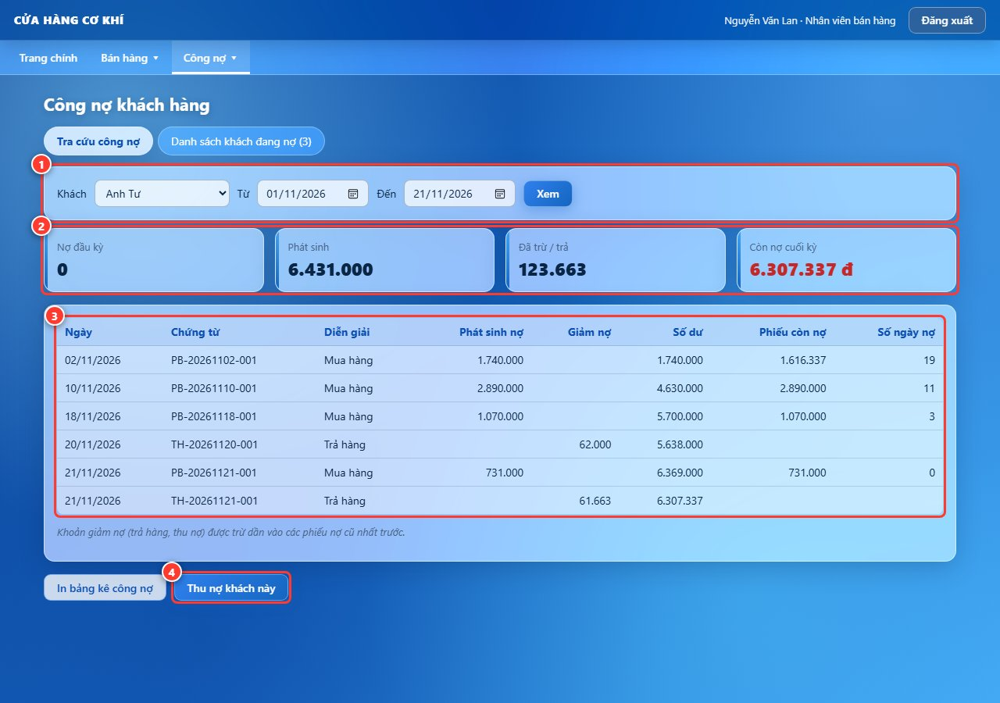

1. Chọn **khách**, khoảng ngày **Từ – Đến** ①, rồi bấm **Xem**.
2. Bốn ô tổng ② cho biết: nợ đầu kỳ, phát sinh trong kỳ, đã trừ/đã trả, **còn nợ cuối kỳ**.
3. Bảng chi tiết ③ liệt kê từng chứng từ:
   - **Mua hàng** (`PB-…`), **Trả hàng** (`TH-…`), **Thu nợ** (`PT-…`), **Nợ đầu kỳ** (`NDK-…`);
   - **Phiếu còn nợ**: phần chưa trả của từng phiếu;
   - **Số ngày nợ**: số đỏ là nợ quá 30 ngày.
4. Bấm **In bảng kê công nợ** để in gửi khách đối chiếu.
5. Bấm **Thu nợ khách này** ④ để thu tiền (xem 2.8).

### 2.8 Thu nợ

1. Nhập **Số tiền thu** ①. Mặc định là toàn bộ số nợ; thu một phần cũng được, phần mềm sẽ báo số còn lại.
2. Chọn **Hình thức** ②: Tiền mặt hoặc Chuyển khoản.
3. Ghi chú ③ nếu cần, ví dụ "Thanh toán T11".
4. Bấm **Lưu phiếu thu** ④. Phần mềm báo số phiếu thu `PT-…`.

> Số tiền thu được trừ vào **các phiếu nợ cũ nhất trước**. Không thu được nhiều hơn số đang nợ.

### 2.9 Danh sách khách đang nợ

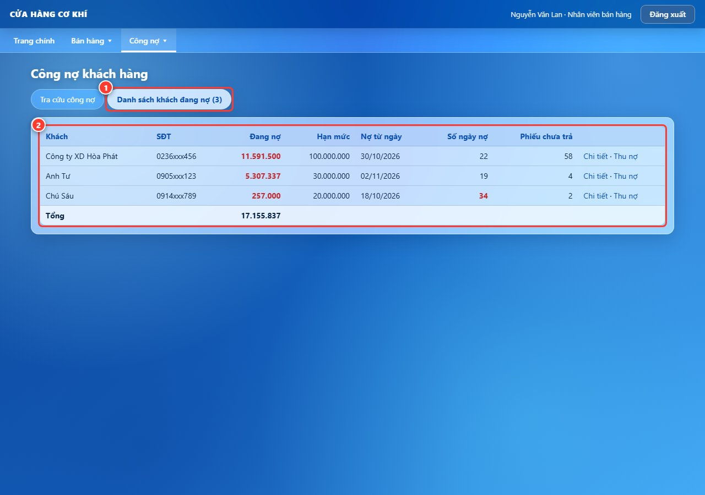

Thẻ **Danh sách khách đang nợ** ① liệt kê ② mọi khách còn nợ: số nợ, hạn mức, **nợ từ ngày nào**, số ngày nợ, số phiếu chưa trả.
Bấm **Chi tiết** để xem bảng kê, **Thu nợ** để thu tiền.

---

## 3. Thủ kho

Thủ kho dùng menu **Tra cứu** (xem tồn kho giống [2.1](#21-tra-cứu-tồn-kho-và-giá), nhưng không có phần báo giá) và menu **Kho**.

### 3.1 Lập phiếu nhập hàng

*Menu:* **Kho → Lập phiếu nhập**

**Bước 1 – Thêm hàng nhập**

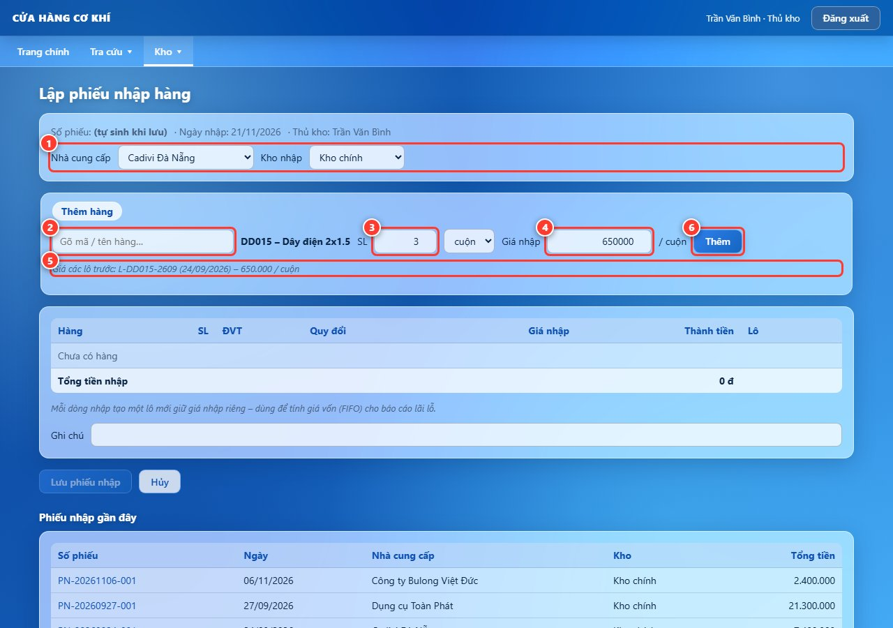

1. Chọn **Nhà cung cấp** và **Kho nhập** ①.
2. Gõ mã hoặc tên hàng vào ô ② rồi chọn trong gợi ý. Hàng đang *ngừng nhập* không có trong danh sách.
3. Nhập **số lượng** ③ và chọn **đơn vị**. Phần mềm mặc định chọn đơn vị lớn nhất, như kg hay cuộn.
4. Nhập **Giá nhập** ④ theo đơn vị đã chọn. Ô này tự điền giá của lần nhập gần nhất.
5. Dòng ⑤ cho biết **giá các lô trước** để bạn so sánh.
6. Bấm **Thêm** ⑥. Lặp lại cho các món khác.

**Bước 2 – Lưu phiếu**

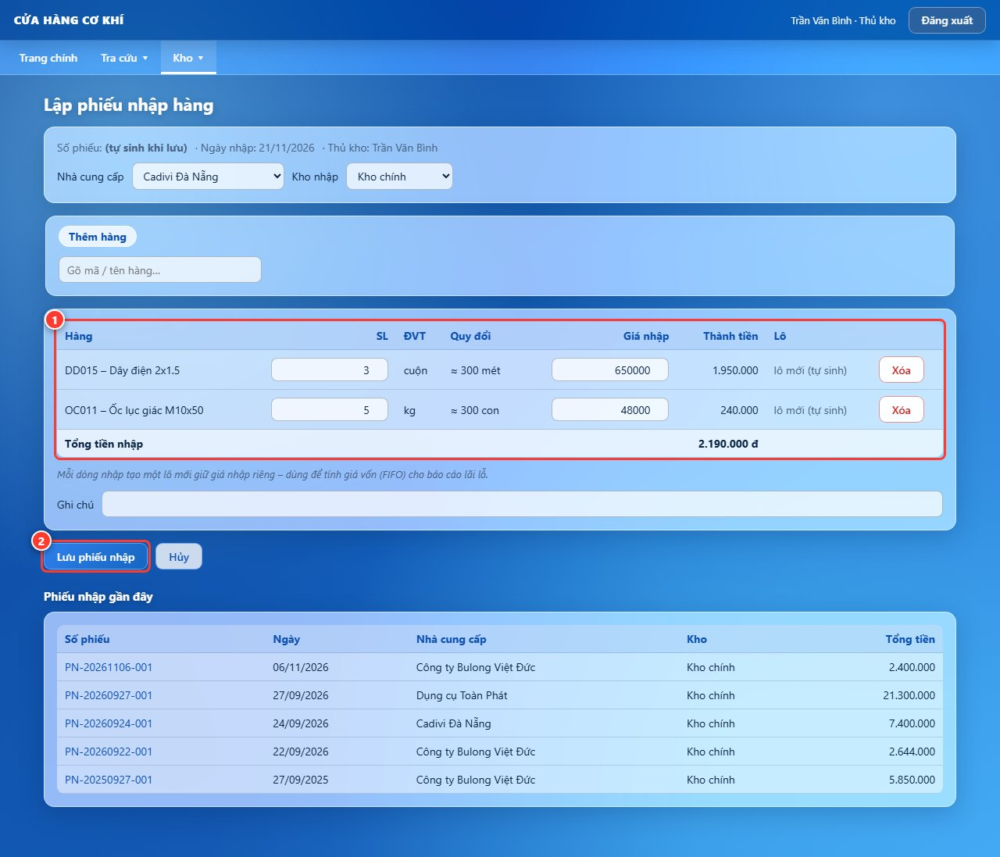

7. Kiểm tra bảng hàng ①: cột *Quy đổi* cho biết số lượng theo đơn vị nhỏ nhất; có thể sửa số lượng và giá ngay trong bảng.
8. Bấm **Lưu phiếu nhập** ②.

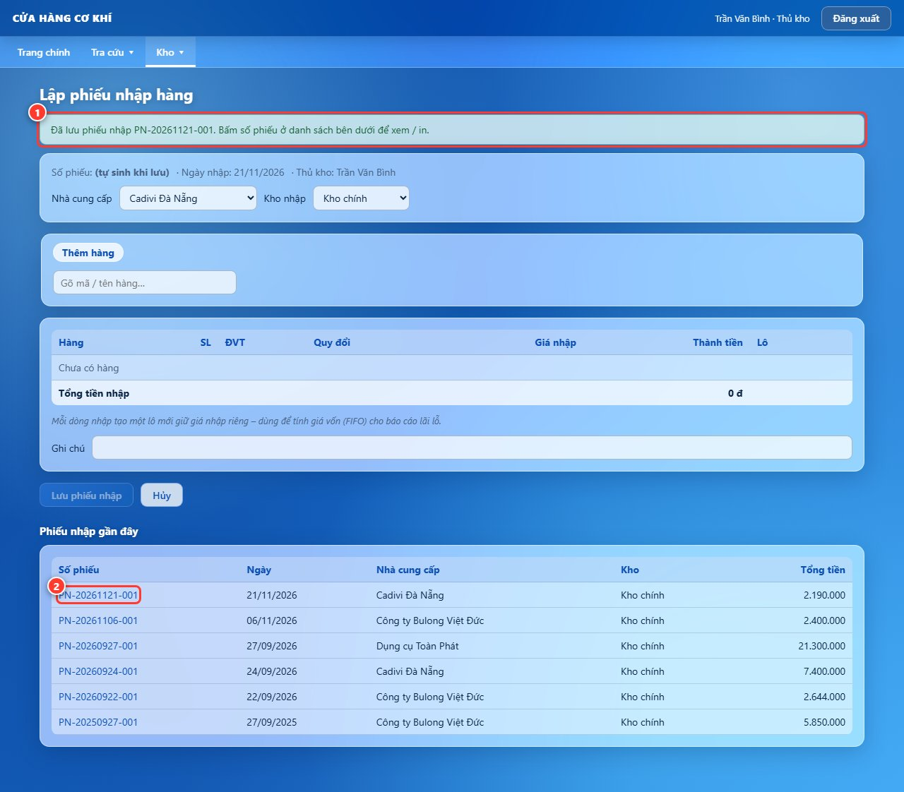

9. Phần mềm báo số phiếu nhập ①. Phiếu mới nằm đầu bảng **Phiếu nhập gần đây**; bấm số phiếu ② để xem hoặc in.

> Mỗi dòng nhập trở thành một **lô** riêng, giữ giá nhập của đợt đó. Khi bán, phần mềm lấy hàng từ lô cũ trước để tính đúng giá vốn và tiền lãi.
> Nhập sai số lượng hoặc giá thì báo chủ cửa hàng sửa (xem [4.6](#46-sửa-giá-nhập--hủy-phiếu-nhập)).

### 3.2 Kiểm kê kho

*Menu:* **Kho → Kiểm kê kho**

**Bước 1 – Tạo đợt kiểm kê**

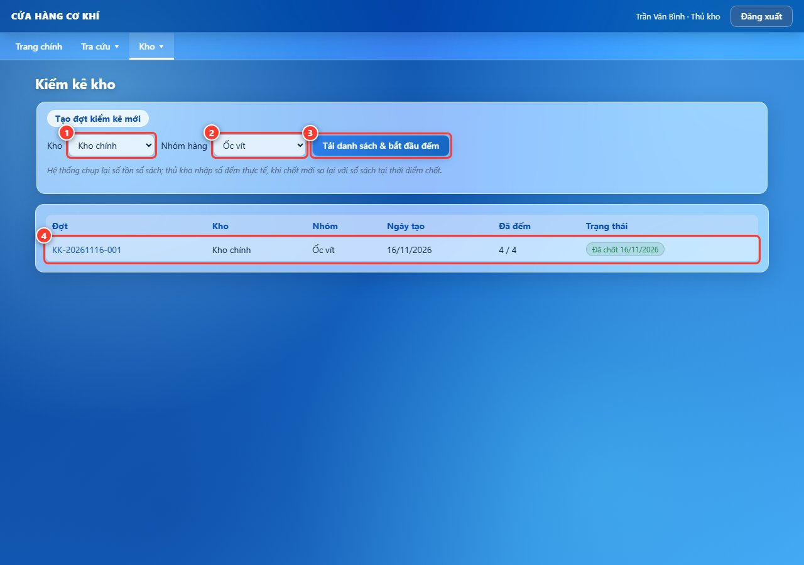

1. Chọn **Kho** ① cần kiểm.
2. Chọn **Nhóm hàng** ② (hoặc *Tất cả*).
3. Bấm **Tải danh sách & bắt đầu đếm** ③.

Các đợt kiểm kê trước được liệt kê ở bảng bên dưới ④. Bấm vào mã đợt để mở lại một đợt đang đếm dở.

**Bước 2 – Nhập số đếm**

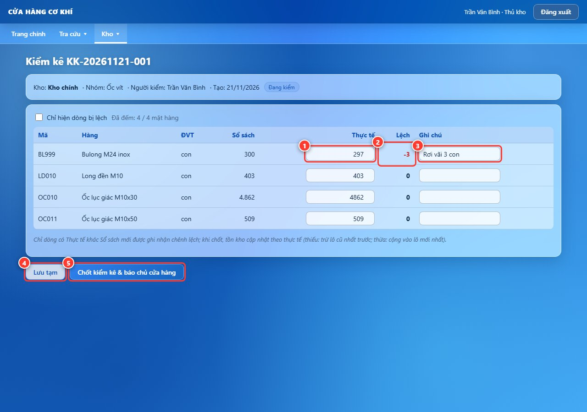

4. Đếm hàng thực tế, nhập vào cột **Thực tế** ① theo đơn vị nhỏ nhất (con, mét, cái…).
5. Cột **Lệch** ② tự tính: **đỏ** là thiếu, **xanh** là thừa.
6. Ghi **lý do** ③ cho dòng bị lệch, ví dụ "Rơi vãi".
7. Đếm chưa xong thì bấm **Lưu tạm** ④, lần sau mở lại đợt này để đếm tiếp.
8. Đếm xong thì bấm **Chốt kiểm kê & báo chủ cửa hàng** ⑤ và xác nhận.

**Bước 3 – Kết quả**

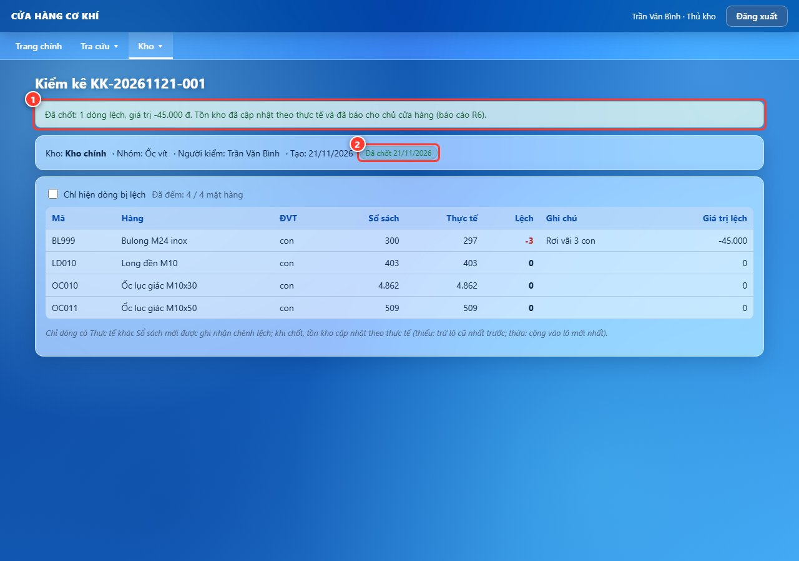

9. Phần mềm báo số dòng lệch và giá trị lệch ①. Đợt kiểm kê chuyển sang trạng thái **Đã chốt** ②.
   Tồn kho được cập nhật theo số đếm thực tế, và chủ cửa hàng xem được chênh lệch trong báo cáo R6.

> Dòng để trống (chưa đếm) sẽ được bỏ qua. Đợt đã chốt không sửa được nữa.

### 3.3 Chuyển kho

*Menu:* **Kho → Chuyển kho**

**Bước 1 – Chọn hàng chuyển**

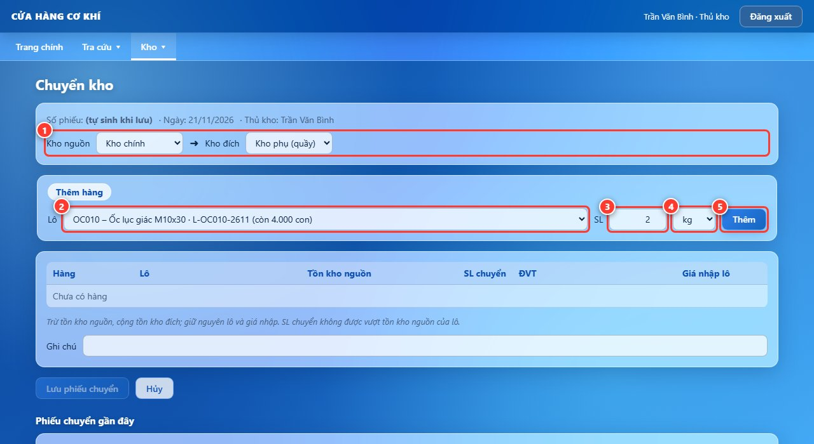

1. Chọn **Kho nguồn** và **Kho đích** ①. Hai kho phải khác nhau.
2. Chọn **Lô** ②. Danh sách ghi rõ mặt hàng, mã lô và số lượng lô còn.
3. Nhập **số lượng** ③ và chọn **đơn vị** ④.
4. Bấm **Thêm** ⑤. Lặp lại cho các món khác.

**Bước 2 – Lưu phiếu chuyển**

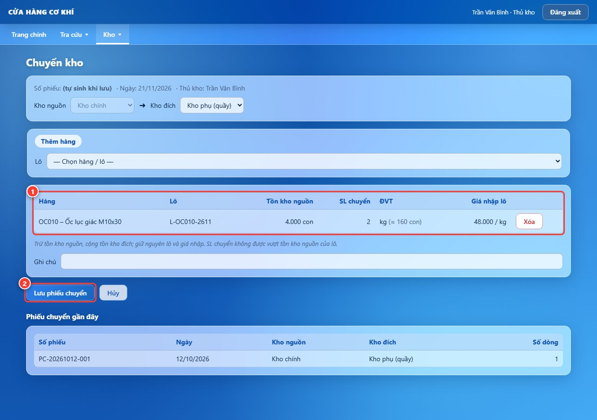

5. Kiểm tra bảng hàng chuyển ①: cột *ĐVT* có ghi quy đổi, ví dụ 2 kg ≈ 160 con.
6. Bấm **Lưu phiếu chuyển** ②. Hàng được trừ ở kho nguồn, cộng ở kho đích, giữ nguyên lô và giá nhập.

> Không chuyển được nhiều hơn số còn lại của lô.

---

## 4. Chủ cửa hàng

Chủ cửa hàng dùng được **mọi chức năng** ở phần 2 và 3, cộng thêm các chức năng sau.

### 4.1 Hàng hóa và đơn vị tính

*Menu:* **Quản trị → Hàng hóa & đơn vị**

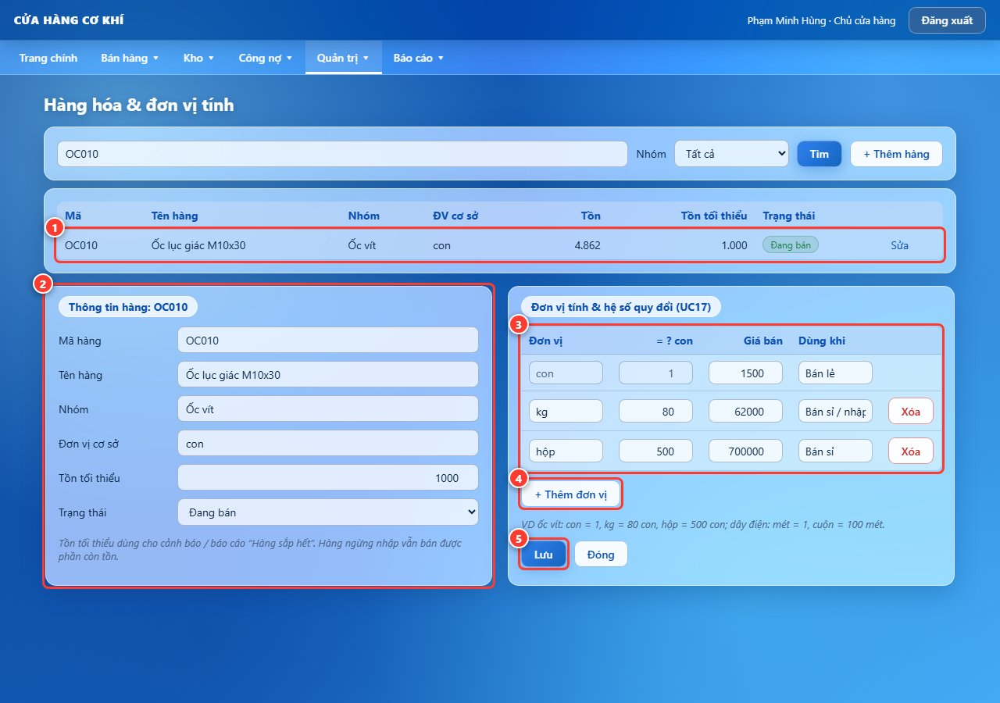

1. Tìm hàng rồi bấm **Sửa** ở dòng cần sửa ①, hoặc bấm **+ Thêm hàng** để thêm món mới.
2. Điền **Thông tin hàng** ②:
   - **Mã hàng**, **Tên hàng**, **Nhóm**;
   - **Đơn vị cơ sở**: đơn vị nhỏ nhất dùng để đếm tồn kho (con, mét, cái…);
   - **Tồn tối thiểu**: khi tồn xuống dưới mức này, món hàng hiện trong cảnh báo và báo cáo *Hàng sắp hết*;
   - **Trạng thái**: *Đang bán* hoặc *Ngừng nhập*. Món ngừng nhập vẫn bán được phần còn tồn.
3. Khai báo **Đơn vị tính & hệ số quy đổi** ③. Mỗi dòng là một cách bán:

   | Đơn vị | = ? con | Giá bán | Ví dụ |
   |---|---|---|---|
   | con | 1 | 1.500 | đơn vị cơ sở, luôn có hệ số 1 |
   | kg | 80 | 62.000 | 1 kg ốc khoảng 80 con |
   | hộp | 500 | 700.000 | 1 hộp 500 con |

4. Bấm **+ Thêm đơn vị** ④ để thêm cách bán mới, hoặc **Xóa** để bỏ một dòng.
5. Bấm **Lưu** ⑤.

### 4.2 Nhà cung cấp

*Menu:* **Quản trị → Nhà cung cấp**

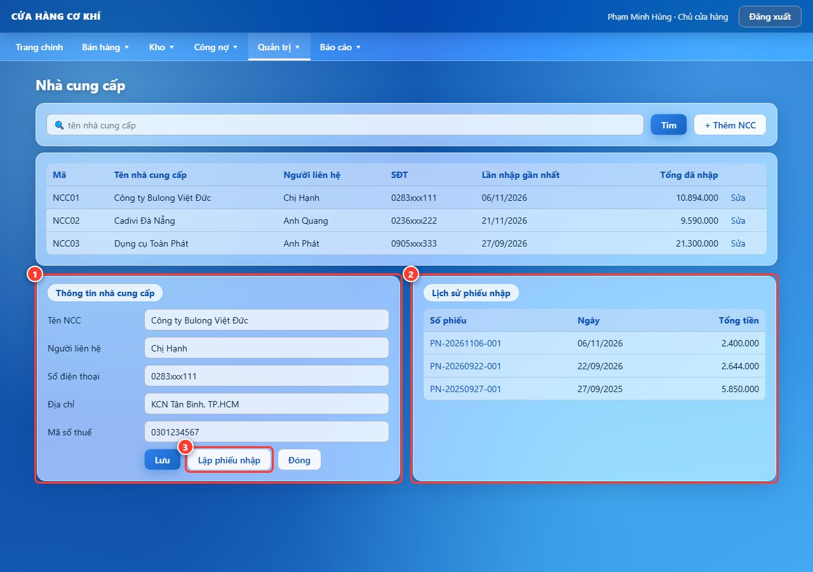

1. Bấm **Sửa** ở một nhà cung cấp, hoặc **+ Thêm NCC**, rồi điền **Thông tin nhà cung cấp** ①: tên, người liên hệ, số điện thoại, địa chỉ, mã số thuế. Bấm **Lưu**.
2. Khung **Lịch sử phiếu nhập** ② liệt kê các lần nhập từ nhà cung cấp này. Bấm số phiếu để xem chi tiết.
3. Bấm **Lập phiếu nhập** ③ để mở phiếu nhập có sẵn nhà cung cấp này.

### 4.3 Nhân viên

*Menu:* **Quản trị → Nhân viên**

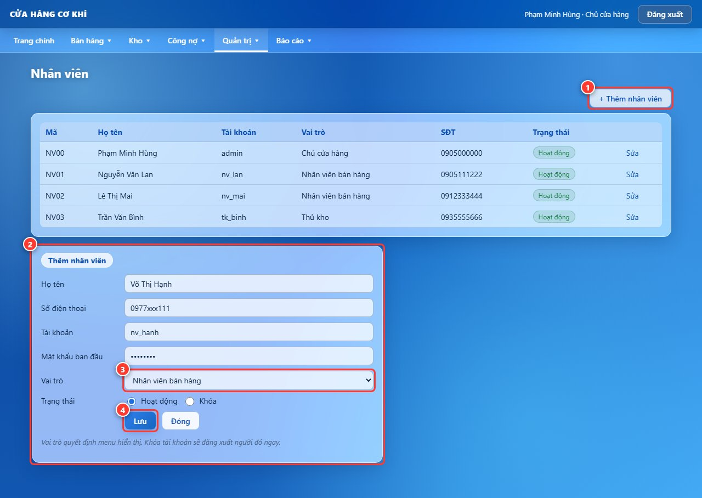

1. Bấm **+ Thêm nhân viên** ①, hoặc **Sửa** ở nhân viên có sẵn.
2. Điền thông tin ②: họ tên, số điện thoại, **tài khoản** (chữ thường, không dấu), **mật khẩu ban đầu** (ít nhất 6 ký tự).
3. Chọn **Vai trò** ③. Vai trò quyết định nhân viên thấy những menu nào:

   | Vai trò | Được dùng |
   |---|---|
   | Nhân viên bán hàng | Tra cứu & báo giá, bán hàng, trả hàng, khách hàng, công nợ, thu nợ |
   | Thủ kho | Tra cứu tồn kho, phiếu nhập, kiểm kê, chuyển kho |
   | Chủ cửa hàng | Tất cả |

4. Bấm **Lưu** ④.

- Nhân viên **nghỉ việc**: chọn **Khóa** rồi Lưu. Người đó bị đăng xuất ngay và không đăng nhập lại được.
- Nhân viên **quên mật khẩu**: mở nhân viên đó, bấm **Đặt lại mật khẩu** và nhập mật khẩu mới.

### 4.4 Báo cáo

*Menu:* **Báo cáo**

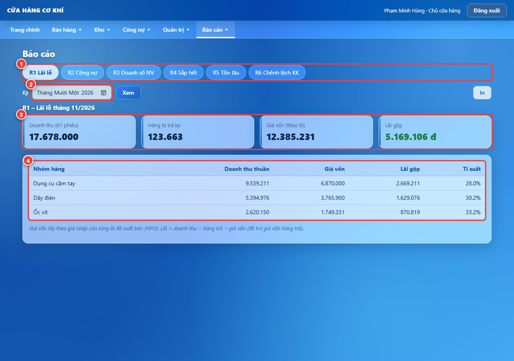

1. Chọn thẻ báo cáo ①.
2. Chọn **Kỳ** (tháng) ② rồi bấm **Xem**. Bấm **In** ở góc phải để in.
3. **R1 Lãi lỗ**: các ô tổng ③ cho biết doanh thu, hàng bị trả, giá vốn (tính theo giá nhập từng lô), **lãi gộp**. Bảng ④ chia theo nhóm hàng.

**R3 – Doanh số nhân viên** (để tính thưởng): số phiếu, doanh số, hàng bị trả và doanh số thuần của từng người; người đứng đầu có biểu tượng 🏆.

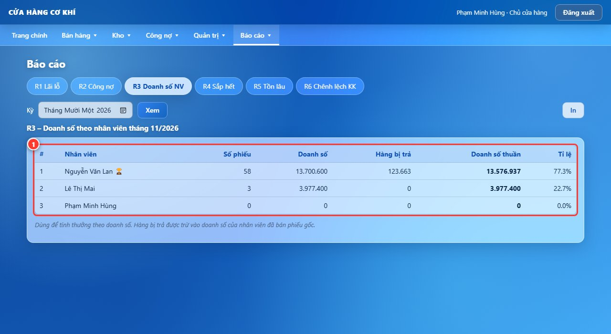

**R4 – Hàng sắp hết**: các món có tồn bằng hoặc dưới mức tối thiểu, kèm nhà cung cấp gần nhất. Bấm **Lập phiếu nhập** ① để đặt thêm hàng.

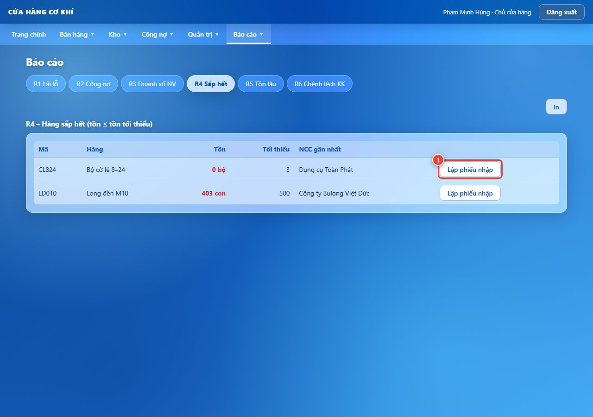

**R5 – Hàng tồn lâu**: chọn số ngày không bán ① (90 / 180 / 365 ngày). Bảng cho biết hàng còn tồn, lần bán cuối và giá trị tồn ②.
Món nào nằm kho quá lâu thì cân nhắc chuyển sang **ngừng nhập**.

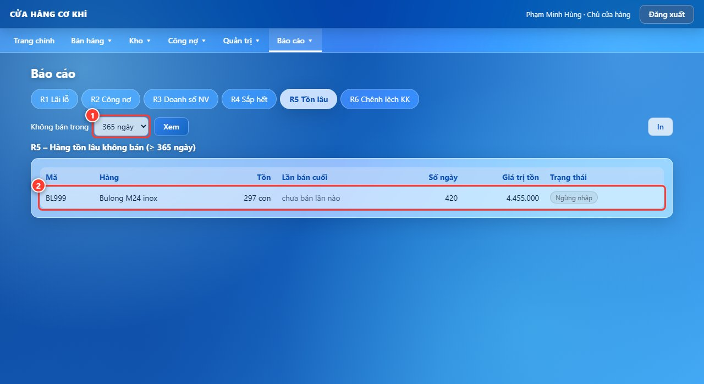

**R6 – Chênh lệch kiểm kê**: các dòng lệch trong những đợt kiểm kê thủ kho đã chốt, kèm giá trị lệch và lý do ①.

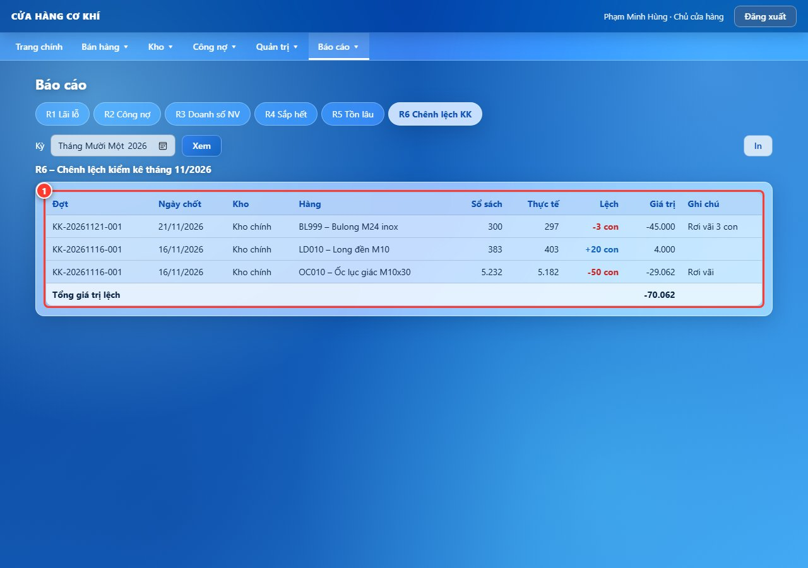

**R2 – Công nợ**: tất cả khách còn nợ, nợ từ ngày nào, số ngày nợ.

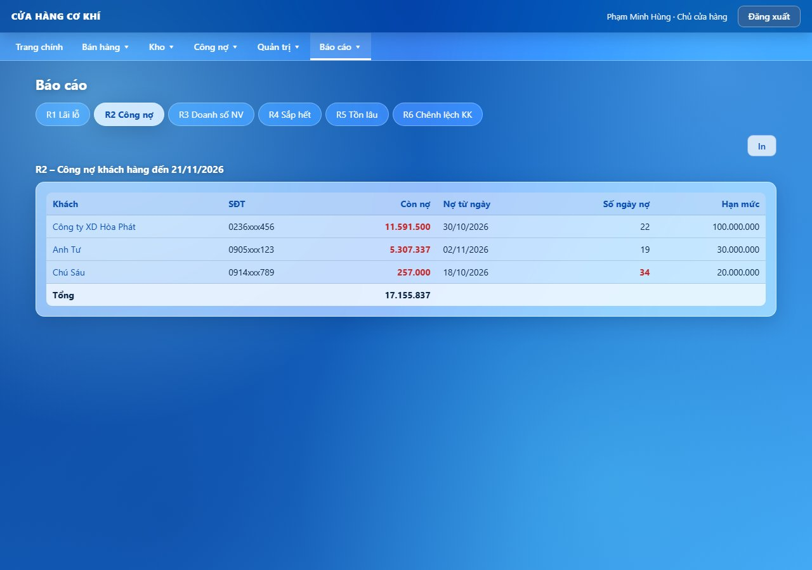

### 4.5 Hủy phiếu bán lập nhầm

1. Mở phiếu cần hủy: **Bán hàng → Phiếu bán đã lập**, bấm vào số phiếu.

   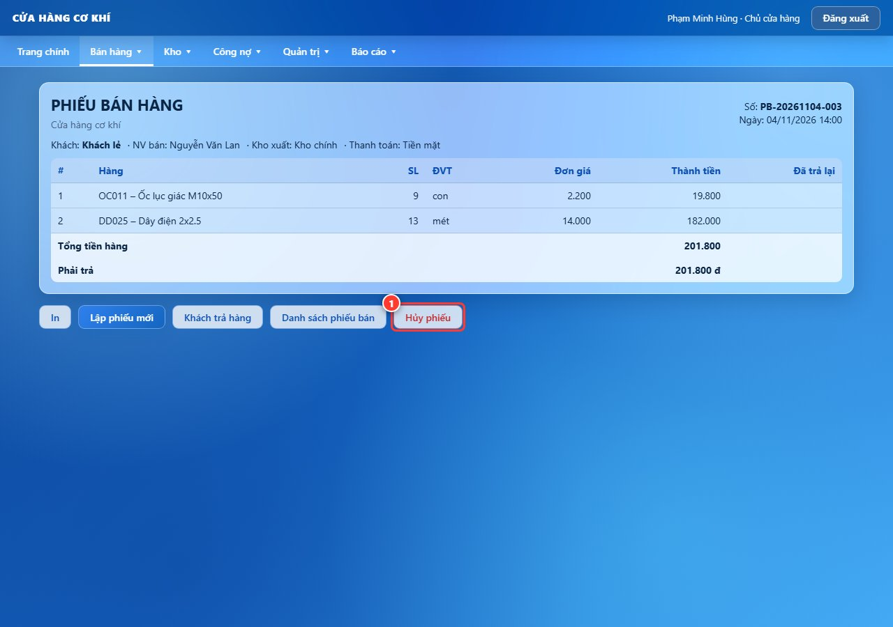

2. Bấm **Hủy phiếu** ①. Nút này chỉ chủ cửa hàng thấy.
3. Nhập **lý do hủy** vào hộp thoại rồi bấm OK.

   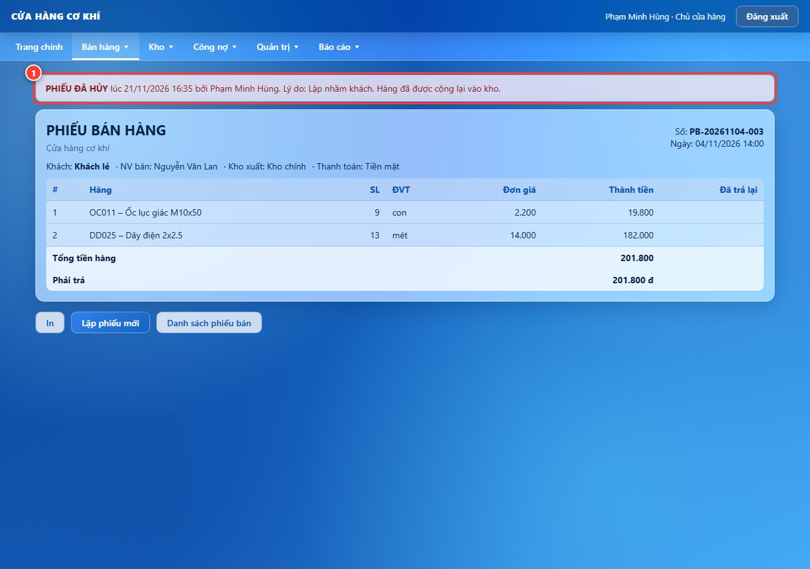

4. Phiếu hiện dòng **PHIẾU ĐÃ HỦY** ① kèm thời gian, người hủy và lý do.
   Hàng được cộng lại vào kho; nếu là phiếu ghi nợ thì khoản nợ của phiếu được bỏ. Phiếu đã hủy không còn tính vào báo cáo.

> **Không hủy được** khi phiếu đã có khách trả hàng, hoặc khách đã trả tiền phần nợ của phiếu. Khi đó dùng [Khách trả hàng](#25-khách-trả-hàng).

### 4.6 Sửa giá nhập / hủy phiếu nhập

Mở phiếu nhập: **Kho → Lập phiếu nhập**, bấm vào số phiếu ở bảng *Phiếu nhập gần đây*. Cũng có thể mở từ *Nhà cung cấp → Lịch sử phiếu nhập*.

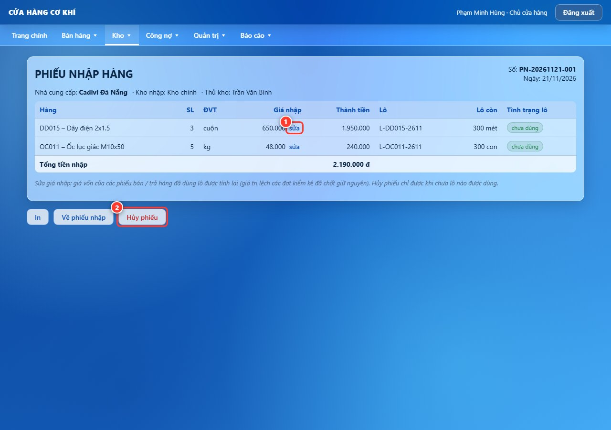

**Sửa giá nhập** (khi nhập sai giá):

1. Bấm **sửa** ① cạnh giá nhập của dòng cần sửa.

   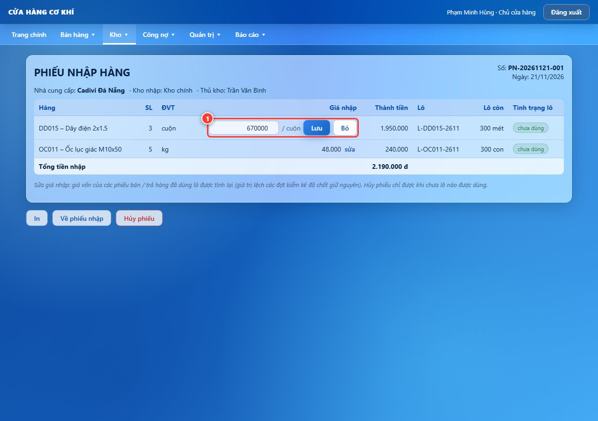

2. Nhập giá đúng ① rồi bấm **Lưu** và xác nhận.
   Giá vốn của các phiếu đã bán từ lô này được tính lại, nên báo cáo lãi lỗ tự đúng theo. Sửa được cả khi hàng đã bán.

   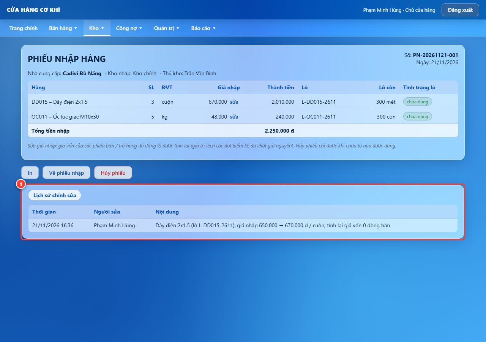

3. Mọi lần sửa được ghi ở khung **Lịch sử chỉnh sửa** ①: thời gian, người sửa, giá cũ → giá mới.

**Hủy phiếu nhập** (khi nhập sai số lượng, mặt hàng hoặc nhà cung cấp):

1. Bấm **Hủy phiếu** (② trong hình *Chi tiết phiếu nhập*) và nhập lý do.
2. Tồn của các lô trong phiếu trở về 0. Sau đó lập lại phiếu nhập cho đúng.

> Nút **Hủy phiếu** chỉ hiện khi **chưa lô nào** của phiếu được bán, chuyển kho hay kiểm kê (cột *Tình trạng lô* ghi *chưa dùng*).
> Hàng đã bán mà số lượng sai thì nhờ thủ kho [kiểm kê](#32-kiểm-kê-kho) để điều chỉnh tồn.

### 4.7 Ghi nợ đầu kỳ

Dùng **khi mới bắt đầu dùng phần mềm**, để chuyển số nợ đang ghi trong sổ tay sang phần mềm.

1. Thêm khách thầu ở **Công nợ → Khách hàng** (xem [2.6](#26-quản-lý-khách-hàng)).
2. Vào **Công nợ → Công nợ & thu nợ**. Cuối trang có khung **Ghi nợ đầu kỳ**, chỉ chủ cửa hàng thấy.

   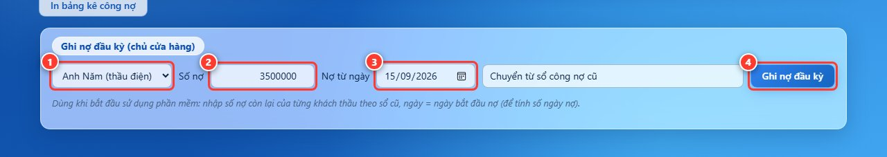

3. Chọn **khách** ①.
4. Nhập **Số nợ** ② theo sổ cũ.
5. Chọn **Nợ từ ngày** ③, tức ngày bắt đầu nợ trong sổ cũ, để phần mềm tính đúng số ngày nợ.
6. Bấm **Ghi nợ đầu kỳ** ④ và xác nhận. Khách nợ nhiều đợt thì ghi nhiều lần, mỗi đợt một ngày.

   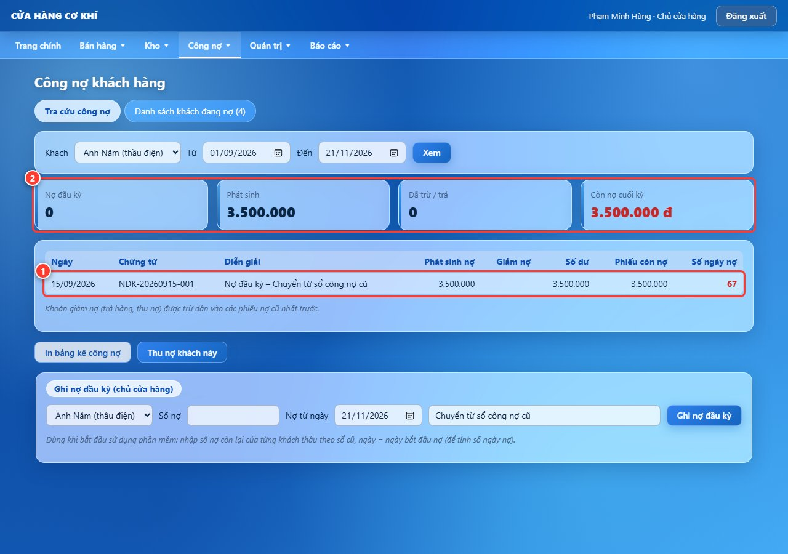

7. Khoản nợ hiện trong sổ công nợ của khách với mã `NDK-…` ①, và được cộng vào số còn nợ ②.

> Chỉ ghi được **trước khi** khách có giao dịch công nợ đầu tiên trên phần mềm (mua ghi nợ, trả hàng, trả nợ). Sau đó phần mềm không cho ghi nữa.

---

## 5. Câu hỏi thường gặp

| Câu hỏi | Trả lời |
|---|---|
| Lưu phiếu bán thì báo **"Không đủ tồn"** | Kho đang chọn không đủ hàng. Giảm số lượng, đổi **Xuất từ kho**, hoặc nhờ thủ kho chuyển kho / nhập thêm. |
| Khách lẻ muốn ghi nợ | Chỉ khách thầu được ghi nợ. Vào *Khách hàng*, đổi loại khách sang **Thầu** và đặt hạn mức. |
| Lập nhầm phiếu bán | Báo chủ cửa hàng hủy phiếu ([4.5](#45-hủy-phiếu-bán-lập-nhầm)) rồi lập phiếu mới. Nếu khách đã trả hàng hoặc trả nợ của phiếu thì dùng *Khách trả hàng*. |
| Nhập nhầm giá hoặc số lượng ở phiếu nhập | Báo chủ cửa hàng sửa giá hoặc hủy phiếu nhập ([4.6](#46-sửa-giá-nhập--hủy-phiếu-nhập)). |
| Tiền trả lại có số lẻ | Phiếu gốc có chiết khấu; phần chiết khấu được chia đều cho từng món ([2.5](#25-khách-trả-hàng)). |
| Bấm vào một trang thì bị đưa về trang chính, báo "không có quyền" | Chức năng đó không thuộc vai trò của bạn ([4.3](#43-nhân-viên)). |
| Đang làm thì bị đăng xuất | Phiên đăng nhập hết hạn sau 7 ngày, hoặc tài khoản vừa bị khóa / đổi mật khẩu. Đăng nhập lại. |
| Cảnh báo "vượt hạn mức" khi ghi nợ | Nợ của khách sau phiếu này vượt hạn mức đã đặt. Phần mềm vẫn cho lưu, nhưng nên thu bớt tiền hoặc hỏi ý chủ cửa hàng. |
| Muốn in phiếu, bảng kê, báo cáo | Bấm nút **In** trên trang. Bản in tự bỏ menu và nền màu. |

---

*Hình trong tài liệu được chụp tự động bằng `web/scripts/chup-man-hinh.mjs` (xem [cai-dat-van-hanh.md](cai-dat-van-hanh.md) mục 9). Khi giao diện thay đổi, chạy lại script để cập nhật hình.*
